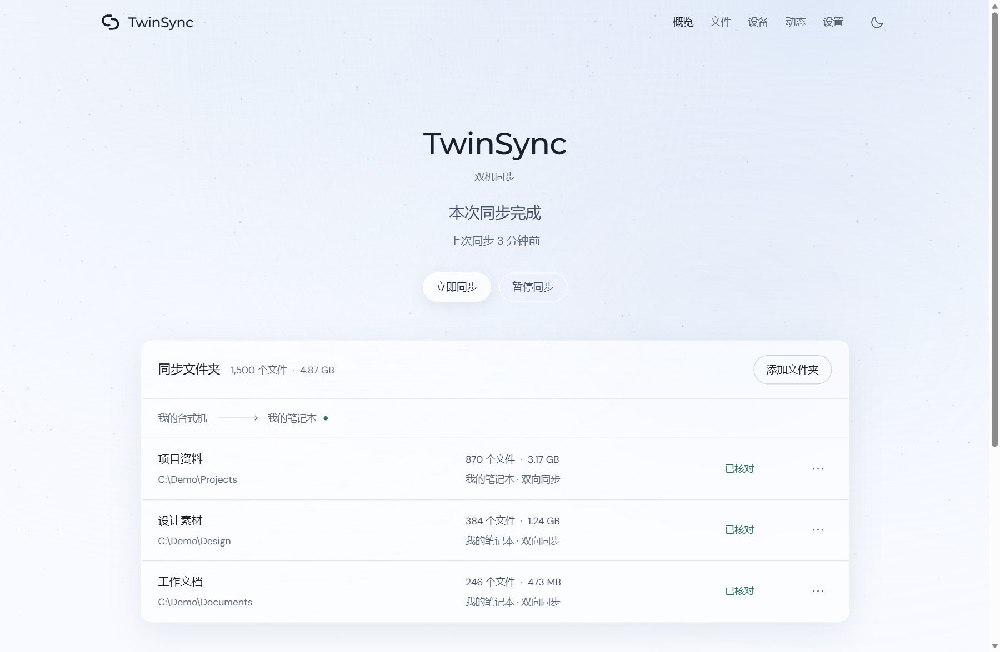
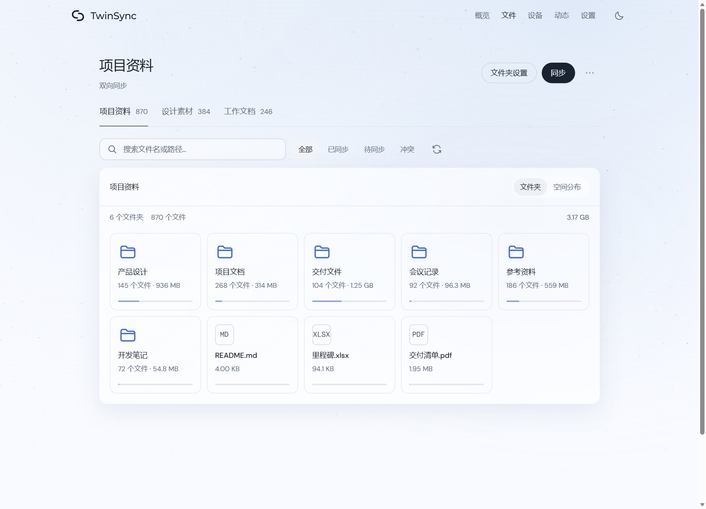
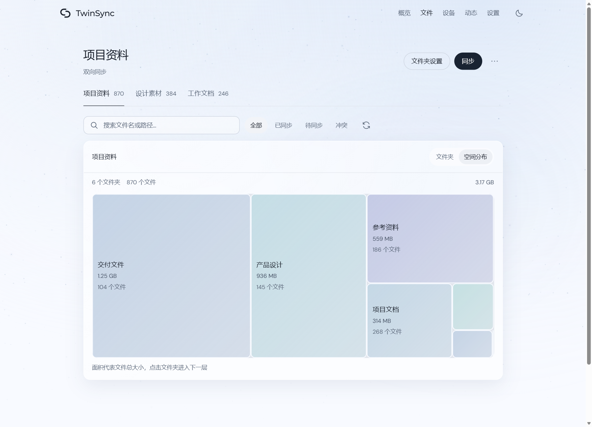
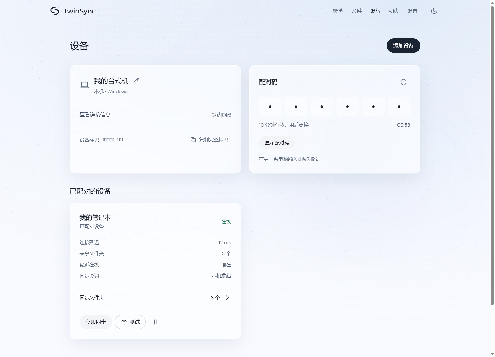

<div align="center">


<h1>TwinSync</h1>

<p><strong>两台电脑，文件同步。</strong></p>
<p>原生 C# 同步核心 · 本地网页管理 · 后台持续运行</p>

<p>
  
  
  <a href="LICENSE"></a>
</p>

<p>
  <a href="https://github.com/NimbusFan/TwinSync/releases"><strong>下载安装</strong></a>
  &nbsp; · &nbsp; <a href="#快速开始">快速开始</a>
  &nbsp; · &nbsp; <a href="#界面预览">界面预览</a>
  &nbsp; · &nbsp; <a href="#构建源码">构建源码</a>
</p>

<p>
  <a href="README.md"></a>
</p>



<p><sub>概览 · 浅色主题</sub></p>

</div>

## 界面预览

| 文件夹浏览 | 空间分布 |
| :---: | :---: |
| <a href="docs/images/files-light.png"></a> | <a href="docs/images/space-light.png"></a> |
| 按目录进入文件夹，搜索、筛选与定位文件。 | 用色块查看占用大小，点击进入下一层。 |

<details>
<summary><strong>查看设备配对界面</strong></summary>
<br>

<p>设备信息按需展开，配对码默认隐藏，共享范围由用户选择。</p>
</details>

## 功能

| | |
| :--- | :--- |
| **文件同步**<br>双向、仅发送、仅接收，支持自动同步与暂停。 | **设备配对**<br>TLS 1.2 加密，核对设备指纹后使用一次性配对码连接。 |
| **文件管理**<br>目录浏览、空间分布、搜索、下载与资源管理器定位。 | **版本与冲突**<br>保留历史版本、查看文本差异、恢复文件与处理冲突副本。 |
| **同步范围**<br>按文件夹选择共享设备，也可只同步指定文件夹或设备。 | **后台运行**<br>Windows 托盘与登录启动，关闭网页后继续同步。 |

## 快速开始

**1. 安装** — 在两台电脑上运行安装程序，选择安装位置。要求 Windows 10/11 和 .NET Framework 4.7.2 或更高版本。

**2. 配对** — 为本机命名，填写对方地址与端口，通过可信渠道核对完整设备指纹，再输入一次性配对码。

**3. 选择目录** — 添加本机文件夹，选择同步方向和共享设备。对方收到邀请后，选择自己的本机目录并确认。

**4. 开始同步** — 点击「立即同步」，或保持自动同步开启。两台电脑可以使用不同的本机路径。

默认管理地址：**http://127.0.0.1:55220**。安装与使用无需 Node.js、npm 或单独安装浏览器运行时。

> 同步会传播被授权的文件修改和删除。首次使用建议先用测试文件夹，重要数据另有独立备份。

安装、升级、暂停、目录迁移和历史恢复的详细说明见 [使用指南](docs/usage.md)。

## 下载

前往 **[Releases](https://github.com/NimbusFan/TwinSync/releases)** 选择版本：

| 文件 | 用途 |
| --- | --- |
| `TwinSyncSetup.exe` | Windows 安装程序，支持自选安装位置。 |
| `TwinSync-source.zip` | 源码、前端资源、文档截图、回归测试与构建依赖。 |

## 构建源码

需要 **64 位 Windows 10/11** 和 **.NET Framework 4.7.2+**。构建使用系统 C# 编译器，无需在线恢复依赖。

在源码根目录打开 PowerShell：

```powershell
# 运行回归测试
powershell -NoProfile -ExecutionPolicy Bypass -File scripts/test.ps1

# 生成安装程序与源码包
powershell -NoProfile -ExecutionPolicy Bypass -File scripts/build.ps1
```

输出位于 `dist/TwinSyncSetup.exe` 和 `dist/TwinSync-source.zip`。

<details>
<summary><strong>项目结构与单独验证</strong></summary>

```text
native/core/      同步服务、网络、安全、索引、版本与托盘
native/setup/     安装器与卸载器
native/assets/    Windows 图标
native/lib/       JSON 依赖及许可
public/          管理界面、字体与品牌资源
scripts/         构建与测试脚本
test/            原生回归测试
docs/            使用、安全、性能、发布说明与截图
```

```powershell
# 安全与同步流程
powershell -NoProfile -ExecutionPolicy Bypass -File scripts/test-security.ps1
powershell -NoProfile -ExecutionPolicy Bypass -File scripts/test-workflows.ps1

# 验证实际安装包
powershell -NoProfile -ExecutionPolicy Bypass -File scripts/test-setup.ps1 -InstallerPackage dist/TwinSyncSetup.exe

# 资源管理器真实桌面检查，会打开并关闭测试目录的新窗口
powershell -NoProfile -ExecutionPolicy Bypass -File scripts/test-explorer.ps1 -Desktop
```

测试使用隔离数据。请勿把真实同步目录用作测试文件夹。

</details>

## 当前限制

- 目前提供 Windows 客户端；自动发现尚未实现，请手动填写对方地址。
- 暂无断点续传，中断后会重新传输该文件。
- 大目录增量扫描、大文件版本对比、批量恢复结果与持久化诊断仍需完善。
- 已有隔离回归与本机桌面检查，尚未完成广泛的长期真机验证或独立安全审计。

## 文档与贡献

[使用指南](docs/usage.md) · [安全说明](docs/security.md) · [性能记录](docs/performance.md) · [贡献指南](CONTRIBUTING.md) · [GitHub 发布指南](docs/publishing.md)

欢迎通过 [Issues](https://github.com/NimbusFan/TwinSync/issues) 反馈问题，通过 Pull Requests 提交改进。安全问题请使用 [私密报告方式](SECURITY.md)。

## 许可证

项目代码采用 **[MIT License](LICENSE)**。实际使用的 JSON 库和字体适用各自的许可证，详见 [第三方组件说明](THIRD_PARTY_NOTICES.md)。
